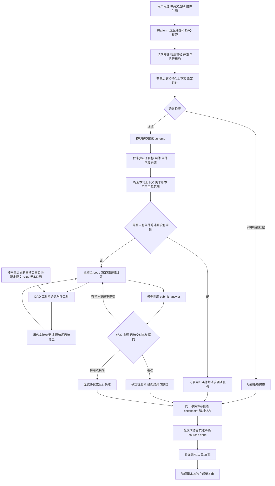
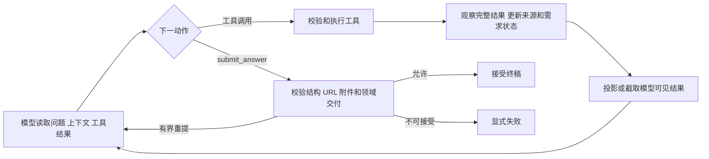
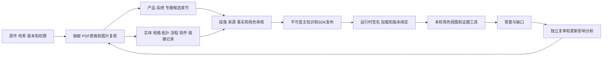

# AI DAQ FAE Agent 工作流设计

版本：v2.2，2026-10-23；资料记载参考层已生产发布，保留限定、失败修复与实际版本身份。

数采 FAE 用一个前置语义抽取阶段和一个模型驱动的工具循环完成咨询。程序负责身份、状态、工具权限、来源适用性和交付协议；模型负责理解用户任务、组织取证、解释证据并回答。后续回答质量改进按这条链路定位最早失效的环节，再修改通用机制。

本文是当前 DAQ 工作流的维护入口，包含实际实现、已知边界和坏例改进流程。历史任务书中的设计目标、已经部署的能力和未完成的能力分别说明。本批针对真实反馈的修复、候选身份及逐题结果见[修复记录](docs/reviews/2026-10-23-daq-real-feedback-repair.md)。**不得针对题目原文、测试编号或某个答案添加固定回复、推荐映射、补写结论或静默降级。**

### 本次资料记载参考层

触发反馈：已有资料不能因为精确硬事实缺证而整体不可用；用户明确授权有歧义附条件上线。最早失效层是知识投影与章节交付：原文未发布，且精读相关原文不能形成可交付的支持证据。

复用现有签名章节与模型工具循环，新增 `source_text` / `document_statement_only` 来源陈述。其 `verified` 仅表示原文和限定已独立核对；不代表设备实测或完整兼容。搜索提供原文摘要，精读后从角色可见的可信正文、记录、原件引用重新计算支持 ID，交付相关资料说法；原目标不因参考资料变成 satisfied，覆盖可显示 partial。精确型号文档不得跨显式变体，产品族指南可参考但不能认证具体 SKU。不同版本并列，PDF 表格列、图片和链接未核实部分明确保留边界。

相邻负例包括错型号/显式变体、错角色、篡改正文/来源、只搜未读和候选预览升格；参考记录不得进入类型化规格集合、产品计数或可查规格字段。通用已审事实、SDK、目录和旧域共享源码不变。不加入固定产品答案或自动补写结论。

执行与验收依据：[参考发布计划](docs/superpowers/plans/2026-10-23-document-reference-publication.md)和[实际生产记录](docs/reviews/2026-10-23-document-reference-production-release.md)。143 项相关合同及独立代码/原文审批通过，4 道新增 Dev 问答共 5 次尝试取得独立接受，实际生产签名加载、健康与公网只读观察通过。UMI 英文题暴露最早身份层缺口：已读资料因缺英文导航别名无法绑定支持，补受审同主体别名后仅重测该题；未加问句规则或放宽证据门。其余三题继承 M1 原身份，不冒称最终 M2 全题重跑。相邻边界保持 UMI 模块/Finger/完整套件不混用，USB 2.0/3.0 文内冲突并列。iOS 已发布文字交付遗漏作为非阻断 P3 保留，不写成资料缺失。

## 1 当前基线和架构边界

### 1.1 版本依据

本次参考层基线为 `4fa9da8`，回答源码提交 `5a55dffa1a44cf4021d56b3a7a3a42de265ec60b`。2026-10-23 已完成最终 M2 单 DAQ 生产切换，通过实际容器默认签名加载、健康及公网只读检查；没有生产模型评测。共享 `src/` 与上游 pin 不变，相机仓及实际相机容器身份/健康未变。

| 对象 | 实际生产身份 |
| --- | --- |
| Agent | `ai-daq-fae-agent` |
| 回答运行时 | `daq-772ca8f76d07` |
| 主知识 | `64a484100fda4e38d519450745700cf978017cb73816019f23f47dd6b57c833c` |
| SDK 知识 | `3c00fa1c798aa90894391583b97368125e2e7c1ce2740a77b28485484fb679a9` |
| 共享源码快照 | `6bad94591dc4c40c29ad054b526c0ec526478607` |
| 回答容器镜像 | `sha256:aa7cff939e9e45af7dc47d7c575016e2d004c076680a45b017906c47ba35163a` |

生产实际加载 **388 条记录、318 个章节、329 个逐段证据单元**，其中新增 310 段受审资料记载；保留原 24 条 SDK 用法、17 条版本说明。系列节点用于原指南范围，不额外计作物理产品；这些库存不等于全部产品或全部问题已覆盖。未审候选章节仍不具权威性。

此前 v2.1 物理/流程修复的历史验收：11 个不同场景已独立复审接受，9 轮继承原通过身份、2 轮最终候选执行。生产签名基于相同记录、正文、角色及源码；只将原件归档/执行范围转为实际核验的生产合同，未冒称在新生产 main 上重跑这些题。原 Dev main `a6a3c6f14e2cdbe7a72c896abd14a94e7a854c195bc6a82ad298a17d7a54f118` 和 SDK `75e04138b5f8dbd03dbd906965b07a1d0211373f7d860acd3d75a12c01126255` 原字节保留，Dev 签名不能直接进入生产。生产包独立审批、实际签名且默认加载不启用 `allow_local_dev`。

此前 v2.1 详情见[生产发布记录](docs/reviews/2026-10-23-daq-real-feedback-production-release.md)、[机制修复记录](docs/reviews/2026-10-23-daq-real-feedback-repair.md)及[管理平台接入记录](docs/reviews/2026-10-22-daq-admin-integration-release.md)。发布期间另观测到 Platform API 的独立镜像/容器变更，公网仍符合检查；其操作者/原因未归因，不能声称所有非 DAQ 容器都未变，详见生产记录。2026-10-08 [完整设计](docs/2026-10-08-数采FAE完整设计.md)中的初始状态不覆盖实际发布结果。

### 1.2 运行边界

- DAQ 有独立应用装配、Agent 身份、知识发布、提示、请求状态、附件和回滚目标。实际与相机共用 PostgreSQL 逻辑数据库及模型网关凭据，DAQ 表位于独立 `daq_fae` schema。共享资源仍可能造成共同延迟或故障。
- `src/` 是按准确上游提交纳入 Git 的源码快照，由 [upstream-source.json](upstream-source.json)和[快照校验器](scripts/verify_upstream_snapshot.py)约束。它不是可随意修改的第二份相机实现。该清单仍注明分支保护尚待核实，不能把“可由远端分支取回”写成“受保护依赖门已完成”。
- 当前回答链不调用相机完整 `Orchestrator`、旧五桶路由或独立 Capability Planner。能力组合由 DAQ schema 和需求账本表达，具体取证次序由 Loop 模型选择。
- 当前是前置抽取加主 Loop 的模型工作流，没有多个独立模型 Agent 相互派单。界面里的 Boundary Guard Agent、Intent Analyst Agent 是阶段名称，不代表各自都有一次模型调用。

## 2 完整执行总图

这是正常认证浏览器入口的执行图。存储、授权或租约失败可能在提交前终止流，此时不发送伪造成功的 `done`。本机离线和 Platform Task 的差异见第 11 节。

## 3 入口 身份和执行所有权

生产浏览器入口为 `/daq/`，API 经 `/daq/api/` 代理到 DAQ。`create_app` 校验 production 模式、认证、主知识、SDK 绑定和 Provider 配置。缺失必要身份、签名或发布配置时拒绝启动，不能自动换成离线空知识。

有效企业成员通过 Platform 获得 DAQ 身份绑定，再建立 DAQ 自己的企业会话。DAQ 校验 Agent ID、成员类型、活跃状态和访问范围；相机会话、匿名用户及合作方不能借用该绑定。当前企业成员映射为已发布资料的 `internal_fae` 查看角色。资料权限在检索前过滤，转发和链接另受 forward 权限约束；`/review` 当前关闭。

认证 `/chat` 要求 `client_request_id` 和 `channel=fae`。`fae` 是通信协议中的渠道名，不改变 DAQ 的 Agent 身份。请求键绑定主体、载荷、会话、附件及知识角色/版本：

| 情况 | 当前处理 |
| --- | --- |
| 相同请求已有终态 | 返回已保存 SSE，逐帧重新检查权限，不重复调用模型。 |
| 相同请求键对应不同载荷 | 冲突拒绝。 |
| 同一会话正在执行或租约状态不允许执行 | 明确 busy/in-progress/interrupted，不自动接管重跑。 |
| 全局并发额度已满 | 429；应用构造默认并发数为 2，不能当作容量验收结果。 |
| 附件不属于主体或会话、已过期或被删除 | 在模型执行前按实际原因拒绝。 |

执行租约定期续约，并在持久化前再次校验。客户端断开会标记执行中断；不能把“浏览器没收到”解释为可以无条件重新执行。参考 [platform_identity.py](daq_fae/platform_identity.py)、[authenticated_chat.py](daq_fae/authenticated_chat.py)、[durable_state.py](daq_fae/durable_state.py)。

## 4 会话和多轮状态

### 4.1 四种信息各自承担什么职责

| 信息 | 当前用途 | 权威边界 |
| --- | --- | --- |
| 用户和助手历史消息 | 保留咨询经过，提供 Loop 的对话背景；历史列表用于回看。 | 助手旧答案不自动成为本轮产品证据。 |
| `DaqTaskContext` | 保存设备、变体、平台、连接、供电、版本、采集任务、存储及已试动作。 | 用户条件记录为 `user_supplied`，区分 asserted/hypothesis。 |
| `grounded_scope` | 保存已发布角色视图解析出的实体和选择器。 | 只用于定位实体；不代替规格或组合兼容证据。 |
| 本轮 schema 和 requirements | 表达这轮究竟问什么、各字段属于哪个目标、需查哪些证据。 | 逐轮生成；不能把上轮 full 覆盖复制为本轮 full。 |

主要语义状态放在 `DaqContextState.task_context`，由 `DaqTaskContext` 的 v3 checkpoint 校验和恢复。外层 `DaqContextState` 还有历史兼容字段；当前浏览器写入路径没有把其中每个字段都填成完整记忆，不能仅因存在字段就声称对应能力已完成。

### 4.2 继承 纠正和失效

`prepare_turn` 记录字段值、来源轮次、用户权威性和是否为假设；`field_lineage` 说明当前值来自本轮还是前轮。`goal_scope_history` 单独保存查询范围线索，例如历史 SDK 版本，避免把“比较的版本”写成“当前安装版本”。`goal_field_lineage` 记录逐目标范围的来源和无依据项。

- 用户明确纠正条件时替换旧值，并记录 `invalidated_fields`。
- 主题切换清空旧用户条件、已试动作和实体接地。模型的 topic_switch 与明确切题语句共同参与判定。
- 当前变体重选后重新绑定实体；无法绑定的新变体不能回落到旧变体。跨产品、跨变体目标不能共用一个全局选择器。
- 分辨率模式、单口/总量、步骤和软件版本尽量归属于各自目标，不能把一句话中某一项的条件套给整轮。
- 知识版本或角色变化时清除旧接地，并将早期助手历史移出本轮模型可见范围；原历史仍保留供审计。用户声明保留，但需用当前发布重新取证。

认证浏览器 schema 只收到最近 8 条消息中的用户原话，必要时补入已有条件陈述；有效问句用真实原话构造，模型提议的改写只作为是否依赖历史的信号。主 Loop 另接收允许使用的对话历史和结构化上下文，不能把这两个输入窗口混为一谈。

参考 [task_context.py](daq_fae/task_context.py) 的 `prepare_turn`、`_goal_scope_provenance`，及 [authenticated_chat.py](daq_fae/authenticated_chat.py) 的 `_prior_for_binding`。

## 5 边界检查和请求理解

### 5.1 边界检查

当前前置检查复用 `categorize_refusal` 的程序规则，识别价格/采购、客户隐私、编造客户案例及品牌攻击等明确红线。它通常不调用模型，也不负责技术任务分类。规则误拦需要检查原问及上下文，不能以“安全需要”直接判正确；知识缺证不能成为越界拒答理由。该检查先于 schema，正则误中会直接阻断后续理解。

### 5.2 一次语义抽取及受控重试

模型通过 `submit_daq_request_schema` 提交结构化请求，不在这一步回答产品问题。输入包含原问、有限用户历史、附件存在性和界面选定语言；输出经 `DaqRequestSchema.from_candidate` 验证。

| schema 内容 | 含义 |
| --- | --- |
| `original_question` / `effective_question` | 原话与实际送往下一阶段的问题，便于检查目标是否丢失。 |
| `goals` | 可组合的服务、产品、附件、澄清子目标，各有稳定 goal ID。 |
| 每个 goal 的 entity/field/conditions | 明确主体、查询字段、变体及本目标的条件。 |
| `topic_switch` | 是否切换咨询主题。 |
| `attachment_dependency` | `unknown / relevant / required_for_answer / not_relevant`。 |
| `confidence` | high/medium/low；不是来源审核结论。 |
| `answer_language` | zh/en；界面明确选择优先于问题、历史和附件语言。 |

原始模型目标数量限制为 1–8，程序拆分归一后的目标最多 16。稳定 ID 由规范化语义生成，不能由模型随意填一个 ID 当作来源。

程序检查实体能否追到用户原话或允许的历史，区分 SDK 名称和产品、变体和测量模式、查询条件和需求目标；同时含有产品/字段/SDK/步骤的领域归一规则。首次结构缺失或不合法时，按错误码最多重提一次；第二次仍不合法返回 `schema_error`，不编造一个默认业务意图继续执行。Provider 错误与 schema 错误分开。

单次重提除了对应错误说明，还附共用 `SCHEMA_RETRY_CONTRACT`，要求重新检查全部目标：规格/身份目标单实体、必要输入分别归属、组合输出不拆成各设备事实、系统条件不复制、未映射条件保留缺口。程序仍独立校验重提结果，第二次非法明确失败，不自动改成一个可通过的目标。

### 5.3 服务身份和产品问题分开取证

“你是谁、能做什么、当前资料覆盖什么”从版本化 `ServiceContract` 回答。服务合同含身份、能力和角色可见库存，可以不查产品工具；其实体记录数不能充当产品款数。产品目录、规格、组合和 SDK 仍需对应工具取证。混合题保留两种目标，服务合同不为产品结论背书。

仅有澄清目标、可选身份目标而没有可执行产品任务时，`context_clarification_done` 可记录条件并给澄清提示，跳过主 Loop。只要同时存在目录、规格、组合或其他产品任务，即使 schema 另有 `clarify`，也必须继续取证并回答可答部分；未知背景不能吞掉明确问题。该门按已验证目标判断，不按问号、型号或原问关键词分支。

参考 [request_schema.py](daq_fae/request_schema.py)、[schema 提示](prompts/daq_schema_extraction.md)、[service_contract.py](daq_fae/service_contract.py)、[workflow.py](daq_fae/workflow.py)。

## 6 需求账本和工具编排

`prepare_workflow` 在语义抽取后校验当前实体接地、跨轮变体重绑，生成 `TurnPlan`、服务合同和 Loop 输入。`TurnPlan` 把每个 goal 转为 requirement，包含目标 ID、能力、实体、条件、关键性、证据类别和是否必须在正文交付。

四类证据义务分别为：

| 类别 | 满足条件 |
| --- | --- |
| `service_contract` | 当前版本服务合同支持该服务目标。 |
| `governed_required` | 本轮对应工具返回范围匹配的已审来源，并明确匹配该 requirement。 |
| `user_evidence_required` | 本轮实际读取对应授权附件来源；仍只证明用户现场观察。 |
| `clarification_required` | 任务或输入缺失，保持未知，不能冒充产品目标已满足。 |

`allowed_tools_for` 保留服务题和纯身份题的窄工具面。其他产品任务统一开放目录、实体、规格、知识搜索和精读，再按目标加入拓扑、流程、软件与 SDK 等专用工具；选型保留完整取证面。附件根据本轮依赖扩展。模型自由选择顺序，没有固定 catalog→spec→SDK 阶梯。

前置 schema 负责表达需要证明的目标，不能因为漏列某个必要输入就永久封死基础取证。例如组合运行时长允许继续查各设备功耗和来源条件，但“查到了功耗”不能把“组合时长已确认”标为 full。必要输入可形成辅助证据单元，见第 9.4 节。定量拆分由模型依照任务和已读证据提出，不按原问、型号或题号补目标。

## 7 当前证据工具

DAQ 基础工具为以下 14 个，附件适配器最多再加入 3 个；`submit_answer` 是终稿协议，不是检索工具。

| 工具 | 读取和返回什么 | 不能据此声称什么 |
| --- | --- | --- |
| `catalog` | 已发布实体目录、类别、产品/变体/组件及去重计数。 | 公司所有产品都已收录；实体条数等于产品款数。 |
| `resolve_entity` | 产品、变体、组件身份和可查询字段覆盖。 | 未实际查出的规格值，或未经确认的别名等价。 |
| `lookup_spec` | 精确实体/变体/字段/条件的已审 claim；`all_reviewed_specs` 查询该主体全部已审规格。 | 异变体、异测量模式的参数；模块值就是整机值。 |
| `inspect_topology` | 已审组件关系、主从、连接、供电与存储拓扑。 | 用接口数量推断组合已兼容、同步已验证。 |
| `lookup_procedure` | 指定任务和实体下的前提、顺序动作、检查点。 | 补编后续步骤或用单个灯态代替完整完成条件。 |
| `check_software_support` | 产品/修订、平台、连接、软件/固件版本及能力的支持证据。 | 缺少记录就不支持；SDK 示例存在就整机兼容。 |
| `selection` | 相关配置与要求的取证入口，供模型综合已核实条件和缺口。 | 固定推荐表、来源未闭合的完整匹配保证。 |
| `search_knowledge` | 已发布章节与未被章节覆盖的记录；SDK/Viewer/固件日志按专门版本范围检索。 | 普通相关片段就是某项精确事实已满足，或片段未写就是全库没有。 |
| `read_doc` | 按 section_id 精读有权查看的已审章节正文。 | 读取章节就自动完成所有类型化目标。 |
| `sdk_evidence` | 特定 SDK、构建、平台、语言、API 的包内用法或示例。 | 示例已编译/实测成功，设备与固件组合已支持。 |
| `official_links` | 单独审核、核验且角色允许交付的官方 URL。 | 包名、本地路径或模型记忆就是可下载入口。 |
| `experience` | 已审现场经验与案例。 | 案例等于规格或适用于所有设备。 |
| `risk` | 已审操作、数据或组合风险。 | 原因、现场状态、文件完整性已被诊断确认。 |
| `session_state` | 当前用户声明和会话条件。 | 用户描述已获官方核实。 |
| `search_attachments` | 授权文件中的相关片段和可精读 locator。 | 用户日志可改变产品规格或官方支持范围。 |
| `read_attachment` | 精读本轮检索已暴露的 locator。 | 允许猜任意路径或读取其他会话附件。 |
| `analyze_image` | 当前授权图片的模型观察结果。 | 未执行视觉就已看图，或凭视觉估计精确像素/尺寸。 |

### 7.1 工具执行合同

每次调用返回 `ToolResult(status, content, sources)`。DAQ 域主要区分 `ok / not_found / conflict / tool_error`：查无当前适用来源、来源冲突和执行故障有不同含义。`ok` 也不自动等于目标完成。

类型化工具进一步返回 `matched_requirement_ids` 及 `requirement_source_ids`，把“哪一个需求”绑定到“本轮哪几个来源”。匹配检查实体、字段、变体、版本、测量条件和证据类型；取到相近资料不能给另一个目标盖章。

目录匹配按目标分别计算 `catalog_by_requirement` 和 `required_delivery_source_ids`：泛称目录展开全部已发布变体；显式多个产品取并集且每个名称必须可解析；目录不要求先选定单一变体。隐藏有子实体的系列节点，物理设备、变体、组件分别计数。最终交付来源并集必须覆盖该目标的完整集合，少列一个变体不能通过；单变体规格仍严格校验选择器。`all_reviewed_specs` 同样是逐条规格的完整集合，不能借概览绕过条件或字段来源校验。

普通章节搜索/精读目前通常返回空的 `matched_requirement_ids`，用于阅读与定位；准确产品义务仍依赖类型化匹配。版本说明有独立匹配规则，其 `release_note_statement_only` 只证明日志表述。该区别影响可回答范围，不能称为任意已审正文都可自动支撑 resolved。

### 7.2 检索和权威来源

当前 DAQ 工具主要消费角色过滤后的本机发布记录、章节排名、SDK 目录和版本说明；请求中不临时抓飞书、扫描 tmp、联网搜索或查询相机知识库。目录、规格和关系的查询以结构化范围为核心，不能把系统概括成只有一次向量搜索的通用 RAG。

检索前过滤 answerable、角色、链接审核与转发权限，章节移除私有审核单元。工具返回结构化来源和范围，不把审核者私有摘录交给模型。完整来源定位用于内部审核与结构化 sources，用户答案正文不展示本机路径和内部记录键。

参考 [domain_tools.py](daq_fae/domain_tools.py)、[reviewed_view.py](daq_fae/knowledge/reviewed_view.py)、[section_search.py](daq_fae/knowledge/section_search.py)、[sdk_catalog.py](daq_fae/knowledge/sdk_catalog.py)、[release_notes.py](daq_fae/knowledge/release_notes.py)。

### 7.3 系列范围、具体型号与组合前提

受审实体通过 `family_entity_id` 关联系列。系列指南允许回答其原有泛称范围，不能反向证明任意子型号或固件已经兼容；原问中的短选择器、完整分辨率或 canonical 型号均参与范围约束，模型缩短查询不会消除它们。

组合记录区分 `query_members`（问题所问设备）和 `prerequisite_members`（文档要求的附加设备），二者无重复且完整划分 `members`。用户没提 HUB 时，可发现要求 HUB 的方案，并明确补充这一前提；用户任何相关分句明确排除 HUB 时，该方案不能标为适用。多个独立目标分别判断，某个产品的排除条件不能无差别污染另一个目标。发布和加载均校验系列关系与组合成员图。

`conditions.task` 是经验证的模型查询意图，记录为 `model_proposed_query_intent`，只与受审 `task_intents` 匹配；不当作用户提供的物理条件。版本、分辨率、数量和现场连接仍需各自来源。泛称指南、配对步骤、跨设备同步精度、某个具体 SKU/固件支持是不同断言。

## 8 模型工具循环

`LoopRuntime.run` 接收有效问题、允许的历史、语言/服务合同/上下文说明、可见工具 schema 和需求账本。模型选择继续取证或提交答案。每次工具结果回传给模型前，领域 EvidencePolicy 观察完整结果并更新本轮账本。

同一回复中的多个工具调用按当前实现逐个执行，不是多个自治 Agent 并行调查。同参重复调用有去重与观测；重复读全文亦有记录，不能靠反复读取同一来源制造覆盖。

### 8.1 控制参数和模型边界

- DAQ 应用默认 Anthropic 协议，默认配置名 `claude-opus-5-5`、adaptive/high、`submit_only_auto`。这是代码配置；真实回显模型以 trace 的 Provider 证据为准，不能由名称证明实际模型权重。
- 前置 schema 通常消耗一次模型调用，主 Loop 至少再有一次；取证、提交修正、截断和传输重试可能继续增加调用。阶段数量不是模型调用数。
- 共享 Loop 默认工具预算 24、运行时长阈值 300 秒。时长检查位于工具执行后的循环控制中，schema、网络重试和持久化另有开销；它不是整个 HTTP 请求必定 300 秒内结束的承诺。
- EvidencePolicy 补证最多 2 次；结构协议、URL、附件和截断另有各自的有界控制，不能说全请求总共只重试两次。终稿缺失或协议失败不能放行自由文本。
- 工具结果模型可见字符默认上限 6000，旧结果全文裁剪默认关闭。账本观察的完整结果与模型最终看见的结果可能不同；长证据问题要检查实际投影和截取，不能假设无损。
- DAQ Provider 适配器会丢弃不能合法续传的无签名 thinking 块，保留传输诊断；不会把私有思考改写为可见正文。没有自动换模型的业务兜底路径。

参考 [共享 Loop](src/agent/loop/runtime.py)、[Provider 适配器](daq_fae/provider_adapter.py)、[共享传输](src/agent/anthropic_transport.py)。

## 9 证据覆盖和终稿交付

### 9.1 需求状态与能力覆盖

`DaqEvidenceSession.observe` 以实际结果更新每项 requirement：

| 状态 | 含义 |
| --- | --- |
| `satisfied` | 该目标有本轮适用证据；服务和附件分别按自己的合同满足。 |
| `missing` | 已尝试的适用查询缺少证据，不等于产品不支持。 |
| `conflict` | 适用来源存在未解决冲突，不能自行选值。 |
| `unknown` | 尚未充分查询、任务未清楚或证据匹配未建立。 |

能力覆盖按同一 capability 下的需求聚合为 full/partial/empty/unknown。它是完成证据义务的机器信号，不是答案语义评分。仅有来源数量、ok 工具状态或 full 字段，均不能证明答案专业且完整。

### 9.2 目标与来源绑定的可见交付

DAQ 为共享 `submit_answer` 显式启用 `delivery_units`。每项包含 requirement_id、对应来源 ID 和直接显示给用户的自然语言事实。当前上限为 16 项、每项 1–8 个来源、正文不超过 2000 字符；同一大目标可拆多项，不能为凑一项丢字段。

终稿门检查：目标存在且 satisfied；来源确实在本轮匹配该目标；必须交付的已满足目标没有被省略。`resolved` 还要求关键需求全部 satisfied。tool_error、附件失效、来源跨目标、条件错配和覆盖门异常不能冒充普通业务缺证。

这解决的是“取到了但没答出来”的可检查部分。单元里的自然语言仍由模型撰写，source ID 正确并不自动证明句子与来源完全等价；数值、因果、范围和工程可用性仍须独立语义复审。

### 9.3 已知部分和未知部分同时交付

| 业务终态 | 内容合同 |
| --- | --- |
| `resolved` | 给总体结论，交付本轮已证实结果和必要条件。 |
| `safe_abstained` | 部分或关键目标尚未闭合；交付全部可核实部分，分别说明缺口。不是整题不答。 |
| `escalate_rd` | 已知部分照常交付，列明需要研发/产品确认的具体事项。 |
| `escalate_fae` | 已知部分照常交付，说明需要现场或人工 FAE 接手的原因。 |

共享协议仍要求 safe_abstained 不填 conclusion 键，缺口放 missing，已知部分放 basis/delivery_units。DAQ 的 [response_language.py](daq_fae/response_language.py)用结构化字段渲染“结论”：先展示已知内容，没有已知内容时展示准确缺口；不再以“当前无法下结论”作为通用标题。机器终态保留，不通过修改 outcome 美化答案。

中英文模式约束模型写完整正文；末端本地化主要处理标题和显式失败提示，不会把一段中文技术答案自动翻译成英文。前端思考面板目前对 safe_abstained 仍显示“安全弃答/关键证据不足”等状态提示，与正文标题是不同展示位置。

产品 A 有来源、产品 B 无来源时，应交付 A，并只限定 B 的未知。产品变体未选定但分别取得两个变体的数据时，应逐项给出各自条件和差异，不能把已知值写成全无资料，也不能合并成单一规格。

参考 [domain_evidence.py](daq_fae/domain_evidence.py)、[终稿结构](src/agent/loop/answer_contract.py)、[回答系统提示](prompts/reviewed_knowledge_system.md)。

### 9.4 必要输入事实与工程推导

`lookup_spec` 取到未直接满足原目标的适用已审 claim 时，可返回 `supporting_evidence`：稳定 support ID、父目标、真实来源、实体、字段、范围和条件，固定 `satisfies_parent=false`。EvidencePolicy 使用原需求和按角色过滤的实体视图独立重算，拒绝伪造父目标、异实体、异变体和未经核实的平台范围。

模型可在 delivery_units 中交付这些已验证输入，主目标仍保持 missing/unknown。例如可列明两种双目各自的功耗上限和“10000mAh 条件下 12h以上”，同时保留 EGO＋WristCam 组合实际续航未知。来源条件不等于用户现场条件；单只功耗、上限、预计时长、额定供电与真实平均负载分别说明。需要计算时只给明确变量和假设下的工程公式，不把假定电压、转换效率、设备数量或用户自述的 20h 写成已核实事实。

该机制保证“能答到什么程度就交付到什么程度”，不保证自然语言自动正确；独立答案复审仍检查条件、数值、比较符、范围及是否真正回答用户。

## 10 失败 持久化和流式展示

### 10.1 错误语义

业务缺证、协议失败、Provider 故障和持久化失败分别归因。schema_error、invalid_answer_contract、预算/时长/截断、provider_configuration_error、provider_rate_limited、provider_unavailable、provider_protocol_error、internal_error 等不能包装成一次正常 safe_abstained。

Provider 400/401/403/404/422 按配置问题处理，429 按限流，5xx 和连接错误按不可用；402 等其他状态保留实际码及对应适配器分类，不能默默改称 503。实际 transport_reason、gateway_error_code、重试次数和回显模型保留在诊断字段。是否“可重试”由真实传输合同决定，不能仅凭网关外层状态猜测。

失败结果使用稳定错误文案并保留 `fallback_used / fallback_reason`；这表示请求失败，不是成功答案的替代物。禁止用它掩盖有据任务未完成。参考 [provider_errors.py](daq_fae/provider_errors.py)。

### 10.2 提交顺序

认证浏览器在最终持久化前构造 working_session，随后用同一 PostgreSQL 事务写入：回答与来源/trace 关联、附件关系、上下文 checkpoint、幂等请求终态及可重放 SSE。提交成功后才发送最终 text_delta、sources、done，并更新内存会话。

因此当前“流式”主要是阶段、工具进度和 heartbeat 实时发送；模型草稿与私有思考不会逐字成为可交付答案，终稿验证和提交后集中发送。持久化失败只发相应阶段错误，不留下一个可见答案却没有对应请求终态的孤儿记录。

### 10.3 Trace 的实际含义

主要阶段是 guardrail、schema、loop、tool_call、coverage、outcome；阶段有稳定 stage_id、开始/完成/错误状态和本阶段 elapsed_ms。阶段耗时不是相对请求起点的绝对偏移，不能相加或排序成虚假起止时间。

schema 记录原问、有效问句、目标、实体范围、置信度、字段来源和失效字段；Loop 记录工具、补证原因、协议错误、Provider 回合、usage 与实际模型回显；done 记录最终版本、来源、覆盖、outcome 和 fallback。网关没有返回的 usage 必须保持未知或下界，不能当 0；Loop usage 也不能直接冒称包含前置 schema 的全请求成本。

用户历史当前主要恢复 role/content，前端对 restored 消息不合成 Thinking 轨迹。完整审计在源端记录中，不能因历史面板没有步骤就声称原请求没有执行。参考 [thinkingSteps.ts](webui/src/thinkingSteps.ts)、[authenticated_persistence.py](daq_fae/authenticated_persistence.py)。

## 11 附件和不同入口

### 11.1 用户附件

上传先做类型、大小、解析与会话归属检查；模型只拿附件描述符及按需工具结果。文本类先检索，再按已暴露 locator 精读；图片使用精确 source ID 调用视觉。附件字节在模型执行前准备受控保护，关系随回答提交。删除、过期、归档及重读遵循原所有权边界，附件不自动进入官方知识。

纯图片观察、现场日志与官方产品事实分别取证。日志中的告警不等于请求最终失败；图上看到接口不等于型号、规格或兼容已确定。视觉失败要记录真实失败和不完整覆盖，不能装作已看图。

参考 [attachment_evidence.py](daq_fae/attachment_evidence.py)、[附件基础服务](src/attachments/service.py)。

### 11.2 入口差异

| 入口 | 共享的领域链路 | 当前差异 |
| --- | --- | --- |
| 生产认证浏览器 | prepare_workflow、schema、目标账本、DAQ 工具、EvidencePolicy、submit_answer。 | 企业身份、持久请求租约、加密 PostgreSQL checkpoint、原子写入、附件和权限动态检查。 |
| 本机 Dev | 真实模型路径使用相同领域组件；可隔离回放知识和角色。 | 离线适配器使用保守程序规划，仅用于工程冒烟；SQLite/本机会话不证明生产持久化或真实模型质量。真实资料/候选预览仍受各自授权合同约束。 |
| Platform HTTP Task | 复用同一 prepare_workflow、工具和证据门。 | 独立签名 audience、任务队列和知识角色绑定；摘录是未核实 hint；附件引用目前显式拒绝。须开关及发布合同共同允许才能启用。 |

Task schema 使用最近 16 条消息中的用户原话；浏览器使用 8 条。Task 的 planning_message 用于前置理解，当前 Loop 接收 user_message，并通过 context_note 收到验证目标；浏览器直接传 prepared.loop_question。Task 不接收同等的 UI 语言参数。不能仅因共享函数就宣称入口参数、生命周期或状态已完全等价。最新发布记录没有单独证明 Task 生产启用，不将“有代码”计成“已上线能力”。

附件依赖另有当前合同差异：DAQ schema 使用 relevant/not_relevant，共享 Loop 接受 supplemental；未识别值会归一为 unknown。浏览器还会把可见图片列表传给 Loop。这是可直接定位的实现差异，具体是否造成误拦或多余视觉调用须随真实坏例检查，本文没有把它写成已复现故障。

参考 [app.py](daq_fae/app.py)、[platform_tasks.py](daq_fae/platform_tasks.py)、[task_context.py](daq_fae/task_context.py)。

## 12 知识生产和持续更新

原件、抽取、候选、审核、发布、检索命中和支持当前问题是不同阶段。资料存在但未发布，必须记为 publication gap；已发布却没取到，是检索/匹配问题；取到却没交付，是覆盖/合成问题，不能全部归为“知识库没有”。

章节按可独立回答的语义主题组织。不同任务的内容不因同属一个产品就全部塞进同一章；搜索摘要会截断，不能让操作模式埋在电气参数章尾。拆分或移动证据单元必须保留原件定位、事实和权限，重新核算受影响单元的 ID/位置及章节指纹并独立审核；未变的记录和正文单元沿依赖关系复用。检索排名及摘要可见性验证仍不能代替实际答案复审。

高频更新按来源哈希和依赖关系增量处理：来源变更或删除使相关事实、章节证据单元和覆盖审核失效；新增来源还可能使旧的“指定范围未找到资料”结论需要重审。数值、单位、测量条件、正文、角色或来源变化均不能继承旧审核签名。没有冲突裁决时保留冲突，其他未受影响的已审事实仍可发布使用。

主知识包含专门 link 记录，SDK 包内用法与版本说明有独立消费范围；包内用法、变更日志、设备兼容和现场验证四者不能互相替代。主知识、SDK、DAQ 代码和上游版本在加载时绑定；当前生产沿签名加载链，不使用仅本机预览的 allow_local_dev。

详情沿用[知识库设计与更新工作流](docs/knowledge-base/knowledge-base-design-and-update-workflow.md)和[证据单元合同](docs/knowledge/section-narrative-consistency-v1.md)。本文不将尚未审核的候选描述为已投入回答。

## 13 管理平台和质量反馈

回答服务保存源端会话、问答、结构化来源、阶段、反馈和 trace 记录；记录的完整程度以实际采集为准。2026-10-23 调查的 8 轮只有根 span 和工具调用摘要，没有工具完整返回或 LLM/工具子 span，不能当成完整原始执行轨迹。Platform 接入沿只读导出 → DAQ 独立管理镜像 → 归一化视图 → 脱敏/匿名化 → 签名/加密副本 → 管理端读取。DAQ 独立 Agent ID 保留，归一化 source_kind=fae 只表示运行时家族，不得混入相机统计。

当前独立采集和云端推送分别为 300 秒周期，积压与故障会延迟；健康探针独立于会话数据新鲜度。云端只开放既有脱敏 trace 摘要，完整步骤明确 unavailable。2026-10-22 已有真实会话导入收据，但没有登录态浏览器验收或生产模型评测，不能用导入成功代替回答质量通过。

用户反馈是问题线索，不自动成为事实裁决、训练知识或已关闭事项。DAQ 本轮接入只做观测同步，`review_backfill=not_enabled/daq_observability_only`；不能把相机完整 Review/outbox 闭环当作 DAQ 已接入。后续修复按下面记录链闭合。

## 14 现有规则和禁止兜底的边界

当前实现不是所有决策都交给模型。为使后续架构升级可审计，以下机制必须如实区分：

| 当前机制 | 当前作用 | 后续改进纪律 |
| --- | --- | --- |
| 鉴权、归属、幂等、租约、schema 类型、来源/权限/URL 校验 | 约束能执行什么、可用什么证据及如何提交。 | 保留通用执行合同，不能为答出一题放宽它。 |
| schema、task_context 中的正则、字段别名、SDK/版本/流程归一与纠正提示 | 校验或调整模型提出的目标、条件和记忆。 | 用坏例检查是否漏义务、过度推断或改变用户原意；不得继续按句式堆分支。 |
| EvidencePolicy 的日志终态、数字条件、语言、内部来源词等文本检查 | 阻止特定无据声明或不合规交付。 | 程序扫描不等于语义审核；验证其误杀、漏检和职责边界，优先用结构化 claim/scope 合同解决重复失败。 |
| 条件陈述的固定澄清 | 没有明确任务时提示用户继续。 | 不能吞掉可回答目标，也不能用它替代模型理解。 |
| empty_knowledge_synthesis | 仅 empty-dev-v0、全部缺证、无来源等严格条件下替换空知识 Dev 答案，并标 fallback。 | 当前非空生产发布不触发；保留为历史 Dev 路径，不作为真实知识回答的补救方案。 |
| 稳定错误提示和确定性章节渲染 | 表达失败或呈现已经验证的模型字段。 | 不新增产品事实、不改变 outcome、不把错误包装成成功。 |

**升级禁令：** 不针对原问/test ID 写 if；不固定产品推荐；不靠增加“如果问 X 就答 Y”提示补题；不在工具空返回后拼一段看似专业的回答；不绕过需求覆盖；不自动切模型、重试到碰巧通过或改写失败记录。

每项拟新增规则都要说明普遍适用的执行合同、来源、影响范围和能推翻它的负例。对语义理解/诊断/工程判断问题，模型负责提出判断；程序验证授权、结构和证据绑定，不能用越来越长的正则回答用户。

## 15 从用户坏例到架构升级

### 15.1 每个问题先保留完整任务

用户给出不满意的问答后，建立一个稳定 CASE ID。保存原问、必要历史、原答案、用户指出的问题；能取得时补 session/turn/trace、语言、角色、附件引用及代码/模型/提示/知识版本。敏感原文和附件放受限目录，Git 中保存脱敏摘要和哈希。

不要求用户先备齐全部 trace 才开始分析。先使用已有问答、来源和本机证据；缺失的历史身份或 trace 精确标记。必要时在隔离 Dev 复现当前任务，不能把新 Dev 结果冒称为那次生产请求的真实根因。

### 15.2 统一定位层

沿用既有对照任务的 L01–L11，保持历史 FIND 与新案例可追溯：

| 层 | 定位问题 | 必须核对的相邻输入输出 |
| --- | --- | --- |
| L01 入口与身份 | 请求、会话、语言或角色是否正确进入 DAQ。 | HTTP/SSE、请求键、Agent/主体/资料权限。 |
| L02 上下文 | 条件是否继承、被纠正、切换或错误当成事实。 | 原话、checkpoint 前后、字段来源、有效历史。 |
| L03 请求理解与接地 | 子目标、主体、字段、测量条件是否正确。 | 原问 → schema → 实体/变体绑定 → requirements。 |
| L04 能力编排 | 模型能否看到并调用所需工具，是否重复/漏查。 | allowed_tools、实际调用、次序、预算与工具反馈。 |
| L05 知识生产与发布 | 有无原件、是否审核、是否进入当前角色可见版本。 | 原件 → 候选 → 发布 → 角色视图。 |
| L06 检索与证据工具 | 已发布证据是否可达且匹配目标范围。 | 精确参数 → 命中记录/片段 → requirement/source 绑定。 |
| L07 覆盖与终稿 | 有据部分是否交付，缺口是否局部保留。 | requirement 状态 → submit_answer → delivery_units → 正文。 |
| L08 提示与控制边界 | 提示、归一、验证和补证是否各司其职。 | 实际提示/schema、门判定、纠正反馈、重提交。 |
| L09 结果与观测 | 答案是否在 SSE、存储、历史或 UI 丢失。 | 后端终稿 → 事务 → SSE → 历史/UI/trace。 |
| L10 配置与发布身份 | 是否使用预期模型、协议、代码和知识。 | 实际构建、Provider 回显、配置、指针、版本差异。 |
| L11 反馈与质量门 | 是否保留原任务、由独立复审验收且真实发布。 | CASE → 根因 → 修改 → Dev/复审 → 发布/观察。 |

优先找**第一次丢失目标、条件或已审事实的位置**。可以记录多个根因，但不能仅因最终短答就直接修改 prompt。归因另区分迁移错接、领域设计缺口、原件缺失、发布缺口、检索/证据缺口、状态、Provider、展示或未定位。

### 15.3 连续改进的执行步骤

1. **冻结失败。** 保留完整任务与已有证据，写清预期应交付什么、哪些内容确实缺证；不以字数代替质量标准。
2. **检查原始链路。** 逐项核对上一表，优先用既有 trace、发布清单和无模型工具探针。涉及复用机制时先查相机准确版本的设计和实现，判断 DAQ 是否遗漏或错接，不能只模仿界面。
3. **提出可验证根因。** 写出失效层、影响的任务类型及相邻正例/负例。知识未发布进入知识工作流；代码错接修接口；取证充分但合成漏答才进入交付/合成层。
4. **设计通用修改。** 说明职责变化、输入输出合同、状态/来源如何保留、调用成本、风险和回滚。重复同类失败时先更新本工作流的边界，避免继续局部叠补丁。
5. **最小实施与回归。** 先让无模型合同或状态用例呈现失败，再修复；真实模型只在隔离 Dev 做必要的原失败和受影响邻题。保留新旧身份和红绿证据。
6. **独立答案复审。** 非回答模型的 Codex 或人工 FAE 阅读原问、上下文、完整答案、来源和 trace，判断事实、范围、已知部分、工程动作、因果方向和语言是否正确。调用成功、来源数量和 resolved 都不能替代此门。
7. **发布并观察。** 实际发布绑定代码、提示、Provider 配置、主知识/SDK、角色和回滚目标。生产只读观察真实用户结果，不发送评测题；Dev 通过和已上线分别报告。

### 15.4 控制验证次数

已通过且未受本次改动影响的场景直接结转证据，不重新跑完整 55 题、13 组多轮或其他历史大题库。失败先定位，修复后另建批次；不反复重试直到出现一次好答案。扩大回归必须对应一个具体剩余风险或共享运行时门，并解释原因。

语义事实、运行可靠性、协议一致性、展示质量四轴分别记录。未知项单列，严重事实或权限错误不能用平均分抵消。共享 `src/` 或共用资源改动还须通过受影响相机旧域保护门；DAQ 知识改动不得改变相机服务。本次修复修改 DAQ 领域代码、提示和隔离 Dev 知识；修复期间生产只读；后续已授权发布仅修改 DAQ 镜像、源码指针及五项运行时/知识/公钥身份配置。共享 `src/`、上游 pin 和相机仓不修改。

案例摘要至少包含：CASE ID、用户任务、版本身份、原失败证据、首失效层、根因及可推翻反例、通用修改、影响范围、最小回归、独立复审、实际发布、回滚与剩余风险。状态区分“已登记、已定位、Dev 已验证、已发布观察中、已关闭”，未定位、权限/资料阻断不得写成已修复。

## 16 维护入口和源码导航

| 责任 | 主要入口 |
| --- | --- |
| 启动与入口装配 | [daq_fae/app.py](daq_fae/app.py) `create_app` |
| 认证浏览器完整执行 | [daq_fae/authenticated_chat.py](daq_fae/authenticated_chat.py) `authenticated_chat` |
| 统一前置工作流与工具面 | [daq_fae/workflow.py](daq_fae/workflow.py) `prepare_workflow`、`allowed_tools_for`、`StageLedger` |
| 请求语义及验证 | [daq_fae/request_schema.py](daq_fae/request_schema.py) `extract_request_schema`、`DaqRequestSchema.from_candidate` |
| 多轮字段与目标状态 | [daq_fae/task_context.py](daq_fae/task_context.py) `DaqTaskContext`、`prepare_turn` |
| 幂等和原子终态 | [daq_fae/durable_state.py](daq_fae/durable_state.py) `reserve`、`complete_turn` |
| 来源与目标覆盖/交付 | [daq_fae/domain_evidence.py](daq_fae/domain_evidence.py) `observe`、`evaluate`、`snapshot` |
| 辅助输入事实及系列/前提图 | [supporting_evidence.py](daq_fae/supporting_evidence.py)、[entity_families.py](daq_fae/knowledge/entity_families.py) |
| 领域工具及需求匹配 | [daq_fae/domain_tools.py](daq_fae/domain_tools.py) `DaqToolBox` |
| 共享循环和终稿协议 | [runtime.py](src/agent/loop/runtime.py)、[answer_contract.py](src/agent/loop/answer_contract.py) |
| 主知识/角色加载 | [reviewed_view.py](daq_fae/knowledge/reviewed_view.py)、[entitlements.py](daq_fae/knowledge/entitlements.py) |
| SDK 和发布绑定 | [sdk_catalog.py](daq_fae/knowledge/sdk_catalog.py)、[sdk_release.py](daq_fae/knowledge/sdk_release.py) |
| 附件隔离与取证 | [daq_fae/attachment_evidence.py](daq_fae/attachment_evidence.py) |
| Task 入口 | [daq_fae/platform_tasks.py](daq_fae/platform_tasks.py) |
| 答案本地化和 Thinking | [response_language.py](daq_fae/response_language.py)、[thinkingSteps.ts](webui/src/thinkingSteps.ts) |
| 既有回归与审计 | [tests/test_workflow.py](tests/test_workflow.py)、[test_request_schema.py](tests/test_request_schema.py)、[test_task_context.py](tests/test_task_context.py)、[test_domain_evidence.py](tests/test_domain_evidence.py)、[质量改进任务书](docs/superpowers/plans/2026-10-20-daq-fae-quality-improvement-task-brief.md) |

改变请求目标、记忆、工具、覆盖、终稿、错误语义、入口参数或评测门时，同批更新本文，写明触发案例、为什么修改该层、通用机制、相邻反例和验证/发布状态。知识细节维护在知识文档中，通过版本和来源链接关联，不把全部产品参数复制到工作流。

相机机制参考入口为相邻 `AI-FAE-Agent` 的 `AGENTS.md`、`docs/AI_FAE_AGENT_ENGINEERING_PRINCIPLES.md`、`docs/DESIGN_INDEX.md` 与 `AI_FAE_Agent_工作流设计.md`。比较时固定准确代码版本，保留成熟机制，同时核对数采自己的产品证据与语义边界。

真实案例入口：[2026-10-23 线上反馈根因调查](docs/reviews/2026-10-23-daq-real-feedback-root-cause.md)。5 个会话、8 轮原始问答显示知识发布缺口、目录目标错误排除变体、集合交付漏检及组合定量目标拆分不足；另保留 63mm 主控和四目精确组合的来源缺口。该调查保留原失败与版本身份；后续实施、Dev 真实答案及独立复审见[修复记录](docs/reviews/2026-10-23-daq-real-feedback-repair.md)，状态不得与生产部署混淆。

版本沿革：v1.0 形成完整执行地图；v1.1 校正历史 trace 采集边界；v2.0 实施真实反馈驱动的目录集合、辅助输入、系列/组合前提、单次 schema 纠正、可执行目标优先及按语义主题拆章，并在隔离 Dev 回放；v2.1 经独立生产审批、实签和默认加载后完成单 DAQ 发布。未添加原问特例，未扩大共享运行时或相机操作范围。
