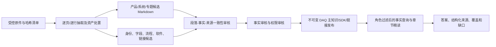

# DAQ FAE 知识库设计与持续更新工作流

**版本：** 2026-10-21 v1
**适用范围：** DAQ 产品、组合系统、软件与 SDK、官方资料入口的候选制备、审核和独立发布。
**本文性质：** 后续实施与更新的执行合同；不替代产品事实审核、资料授权或发布批准。

## 1. 为什么要调整

相机 FAE 的成熟基线是“型号正文 + 事实矩阵 + 专门 SDK/链接证据 + 检索”。DAQ 已有哈希原件、逐页抽取、候选章节、类型化记录和不可变发布能力，但知识没有在这些层之间充分流动。按 2026-10-20 的[增量发布记录](../reviews/2026-10-20-daq-quality-improvement/spec-extension-release-20261020.md)，主知识为 65 条记录，其中 55 条规格 claim；[对应发布清单](../../tmp/daq-spec-extension/final-main/releases/1b6b2057f2ae9293204d3a522245d29f0bb1dbedd762e3bd9418a9060b6d2d3a/manifest.json)有 0 个已发布章节。此前 A2/A3/A4 共制备 114 个产品、系统和指导候选章节；候选数不能当成运行时可用数。

本设计的目标是让一个 DAQ 问题所需的**身份、硬事实、背景解释、操作步骤和缺口**都能从同一受审发布中取得，并且逐项追到原件。安全边界保持不变：冲突不自动裁决，未核实的软件组合不承诺支持，资料权限在模型读取之前生效。

### 1.1 完成口径

“原件入库”“PDF 有文本”“Markdown 已写”“事实已审核”“章节已发布”“工具可取到”是六个不同状态。每一层单独记账，不能用上游数量证明下游质量。质量提升的主要结果应是：已审章节和事实共同进入发布，覆盖状态能指出遗漏，新增或变更原件能触发精确重审。

## 2. 分层结构与权威边界

| 层 | 保存什么 | 权威性与消费者 |
| --- | --- | --- |
| 原件 | 文件字节、SHA-256、大小、来源、文档内版本/日期、语言、访问范围、恢复位置 | 审核依据；原件库存本身不提供答案。 |
| 抽取 | PDF 页文本及页码、MD/TXT 行定位、表格/图片/OCR 的复核标记、抽取器版本 | 私有候选；不能自动变成产品事实。现有入口为 `daq_fae/knowledge/source_import.py`。 |
| 可读章节 | `products/<entity>/`、`systems/<topology>/`、`topics/` 的高密度正文 | 先为私有候选；只有逐段核对、事实及权限复审后才进入主发布。 |
| 类型化记录 | `entity / claim / topology / procedure / software / link`，包括值、单位、比较符、条件、版本和精确来源 | 已审记录按角色提供确定性查询；不从单件参数推断组合性能。 |
| 覆盖与冲突 | 实体×字段×条件、系统×步骤、软件×组合的状态及审核范围 | 说明“已发布、仅候选、冲突、已审计无资料、未审计”；缺证不等于不支持。 |
| 发布与消费 | 内容寻址清单、角色视图、事实工具、章节搜索/精读、SDK/链接工具 | 只有活动且通过加载器验证的版本可服务请求；相机 FAE 指针独立。 |

**逻辑目录**沿用[既有知识系统设计](../superpowers/specs/2026-10-10-daq-knowledge-system-design.md)：产品用 `index/product/hardware/software`，系统用 `overview/setup/recording/troubleshooting`，横切主题单列。资料不足可以缺文件，但入口必须写清覆盖与缺口。受限正文、抽取结果和审核账本放在 Git 忽略的私有目录；Git 中只放合同、工具和脱敏审计摘要。

## 3. PDF、Markdown 与资产清洗标准

### 3.1 每份原件的处置

以产品归档的 276 件清单为起点，其中 27 件可提取文本、249 件资产；这不是 276 份可回答文档。[A1 来源处置](../../data/knowledge/curated/a1-20261010/source-disposition.json)是现有底稿。每件原件必须保留唯一的路径与字节哈希身份；同字节副本、同名异版、中英文对应件和历史版分别标记，不能按文件名日期自动确定新旧权威。资产登记类别、用途、版本/脱敏风险和是否需要专项视觉或包内审核；不强制把图片、固件、安装包转成正文。

### 3.2 PDF → 可读知识的步骤

1. **核对文件身份。** 校验原件哈希和大小，记录文档内版本、语言、页数、资料密级与适用产品；文件名只作定位线索。
2. **逐页抽取。** 保存抽取器版本、页码和页文本哈希。空白页、扫描页、合并单元格、旋转表格和图中参数标记为人工视觉/OCR 复核对象；OCR 输出仍是候选。
3. **逐表复核。** 对照 PDF 页面检查列头、行头、脚注、合并单元格、单位、`< / ≤ / > / ≥`、测试条件和变体。不能仅凭纯文本顺序配对数值。重要表格保留页图或复核定位记录在私有审计中。
4. **按知识主题重组。** 删除页眉、页脚和分页噪声，把规格写入产品硬件章、使用步骤写入软件或系统章；保留来源版本、适用条件和缺口。不是要求“一份 PDF 生成一份 MD”。
5. **双向核对。** 每段结论有精确页/行和原件哈希；每个重点原件页/表有“已入章节、冲突、重复/历史、仅索引、待裁决”的处置。两方向都能查，才能发现清洗遗漏。
6. **隔离冲突。** 原件内部或跨语言、版本冲突时保存双方原文与定位，正文只可说明“资料冲突、未裁决”，不得挑一值写成确定规格。

现有 A2 曾从 15 份原件复核 35 个精确位置，得到 8 个产品的 31 个 Markdown 文件、66 节；这是可复用候选底稿，[审计记录](../knowledge/2026-10-10-daq-a2-product-chapters-audit.md)明确其审核与发布仍未完成。后续更新须增量核对受影响页和章节，同时保持未变更内容的来源关系。

## 4. 事实矩阵与覆盖矩阵

每条规格事实至少包含：稳定 `claim_id`、`entity_id`、字段字典 ID、原始表值、归一化值、单位、比较符、条件、硬件/软件版本、来源哈希与页/行、审核状态、事实审核指纹、查看和转发权限。字段同义词只帮助查询，不能改变测量对象。EGO 1600/1920、EGO Pro、EG-DB 等实体不能因名称相近而合并。现有主知识记录合同继续作为发布格式；不另造一套互相冲突的 `facts.yaml` 在线权威。

覆盖矩阵的最小主键是 `entity_id × field_id × scope/conditions`；系统流程增加 `topology_id × step/condition`，软件增加 `entity × revision × platform × connection × SDK/Viewer/firmware × capability`。每个单元记录：原件集合、候选记录/章节、发布记录/章节、状态、缺口原因、审核范围、上次复核时间及受影响依赖。状态严格区分：

| 状态 | 可说什么 |
| --- | --- |
| `reviewed_published` | 在记录的范围、条件和角色内回答。 |
| `candidate_pending` | 内部工作区有线索；用户侧不作确定结论。 |
| `conflict_pending` | 仅在冲突可见性经过权限审核时陈述允许公开的分歧；不任选一值。 |
| `audited_no_source` | 指定审计范围未找到资料；不推出设备不支持。 |
| `not_audited` | 尚未完成检查；不能伪装成“无资料”。 |
| `verified_unsupported` | 只有明确的权威负面证据且条件匹配时才能使用。 |

字段矩阵应支持“PDF 表格有该字段但主发布无记录”“记录有值但章节无解释”“章节有数值但类型化事实未核对”等差异审计。相机 FAE 的字段覆盖和来源审计可作机制参照，但其 `doc_extracted` 与 DAQ `verified` 的审核语义不同，不能直接换算数量。

## 5. 叙述章节如何安全发布

[现有章节发布 v2 合同](../knowledge/section-release-v2.md)会对类型化断言块核对值与依赖；普通叙述目前是 `uncovered_body`，[B2 一致性合同](../knowledge/section-record-consistency-v1.md)也明确不认证任意自然语言。因此不得把 A2/A3/A4 的 114 节直接改成 `verified`，也不得仅用正文哈希或审核人名字绕过一致性门。

新增的叙述核对合同以**证据单元**覆盖全文：每个可陈述的段落、表格行或流程步骤有稳定单元 ID、正文片段哈希或精确跨度、知识类型、实体/拓扑、适用条件、精确来源定位、类型化记录依赖、审核结论和角色。发布器要求正文中每个实质断言都归属一个证据单元；标题、导航和格式文本可按明确规则豁免。数值、单位、比较符和条件仍必须与已审 claim 完全一致；流程前提、步骤、检查点、失败分支与已审 procedure/topology 一致。纯解释性摘要可以由审核人逐段对照原件签认，但不能偷偷新增硬参数或组合保证。

章节审核绑定正文、全部证据单元、来源、记录依赖、条件和角色的内容指纹。任何一项改变都使旧审核失效。来源或权限不同的内容拆节；URL 仍由独立 link 记录及工具交付。先用少量真实产品和系统章节打通这条合同，再分批处理其余候选。

## 6. 一次新增、修改或删除资料的标准工作流

| 步骤 | 执行动作 | 必须留下的证据 |
| --- | --- | --- |
| 0. 确认基线 | 读取实际活动主知识、SDK、链接及运行时代码 ID；对照发布记录，不把本机旧指针当线上状态。 | 基线 ID、角色、时间和只读加载结果。 |
| 1. 接收原件 | 登记提供者、资料类型、访问级别、文档内版本与适用产品；写入受控归档。 | 原件哈希/大小、恢复位置和权限。 |
| 2. 比较变更 | 按哈希判断新增、字节变化、删除或同字节重命名；记录抽取器版本变化。 | 旧新来源差异及原因。 |
| 3. 抽取与清洗 | 按第 3 节复核受影响页/行、表格和资产；更新私有章节候选。 | 页/行复核账本、章节 diff、冲突/缺口。 |
| 4. 扩散影响 | 用现有[更新影响合同](../contracts/knowledge-update-impact-v1.md)追踪来源→事实→章节→覆盖单元；删除来源撤回依赖的正向证据，新增来源重查相关负面/空白单元。 | 受影响 ID 清单、可复用与失效审核清单。 |
| 5. 归一化与审核 | 比较原始值、单位、条件和实体；事实审核与权限审核分别完成，软件与链接走专门审核。 | 决议、审核人/日期、内容与权限指纹；未决项保留候选。 |
| 6. 编译与核对 | 校验记录、章节证据单元、冲突、依赖、角色、URL 和覆盖矩阵；构建不可变候选发布。 | 静态审计、清单 ID、旧版 ID、范围差异。 |
| 7. Dev 消费检查 | 在独立 Dev 版本上验证各角色工具能按实体/条件取得事实、章节与缺口；必要时做真实问题回放和独立语义复审。 | 同一 release ID 下的工具取证和复审记录。 |
| 8. 显式切换 | 按现有发布流程切换 DAQ 主知识及关联 SDK/链接绑定；只读检查加载、角色视图和来源。 | 切换前后指针、运行时代码 ID、回滚目标和观察记录。 |

任何一步失败都保留旧活动指针。工作区候选、Dev 预览、代码提交和生产发布是不同状态；真实生产发布仍按仓库现有审批与部署合同执行。回滚选择上一不可变版本，不线上手改 JSON。用户附件和现场日志只作当前会话线索，除非另走原件接收与审核流程，否则不进入官方知识。

## 7. 每批质量门与记录模板

每次更新交付一份脱敏摘要，私有账本保留完整路径与原文。摘要至少列：输入来源清单哈希；27 份文本及新增文本的处置覆盖；资产处置变化；新增/变更/撤回的事实、章节和覆盖单元；冲突与缺口；事实/权限审核情况；主知识/SDK/链接发布 ID；各角色可见数量；章节与记录一致性结果；旧版与回滚 ID；未关闭问题及责任角色。

**拒绝发布条件：** 来源哈希或定位失效、主体/变体/条件不明、冲突被写为确定值、正文存在未覆盖实质断言、事实和章节数值不一致、权限混合、未经核验 URL、软件包存在被写作设备组合支持、运行时加载器不接受清单。静态通过只证明格式和关系；事实正确性仍由独立原件复核承担。

维护分工：资料接收/清洗者负责候选与双向覆盖，产品事实审核者负责值和适用范围，资料权限审核者负责查看/转发，发布操作者负责清单与回滚记录。一个人可兼任，但每种审核必须留下独立决定；自动脚本不得冒充审核者。

## 8. 与现有合同的关系

本工作流承接[DAQ 完整设计](../2026-10-08-数采FAE完整设计.md)和[知识系统设计](../superpowers/specs/2026-10-10-daq-knowledge-system-design.md)，不重新定义身份鉴权、模型回答或生产部署。优先复用 `source_import.py`、`candidate_sections.py`、`normalization_review.py`、`section_consistency.py`、`update_impact.py`、`releases.py`、`reviewed_view.py` 和 `domain_tools.py`。新的工作只补“来源/字段覆盖闭环”和“叙述章节可审核发布”这两个断点。具体交付顺序见[质量提升任务书](2026-10-21-knowledge-base-quality-improvement-task-brief.md)。
