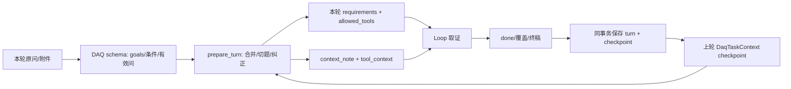

# A5：入口合同与上下文字段生命周期

## 1. 入口先于模型

相机仓的 `SessionContext` 合并 schema、在独立换题时重置咨询状态，并以原问/有效问/字段 trace 追溯（[A2](02-camera-baseline.md)）。DAQ 的实际对应是 `daq_fae/workflow.py:145-253` 的统一 `prepare_workflow`、`daq_fae/task_context.py:89-142,245-350` 的 `DaqTaskContext`，以及认证入口的 `daq_fae/authenticated_chat.py:128-268,370-415`。两者机制不同；对照不变量是**用户条件的来源、进入本轮的字段、失效和使用结果可追**。

| DAQ 入口 | 角色/资料与附件 | 状态读写 | 本轮可验证范围 |
| --- | --- | --- | --- |
| 认证 Web/API | `platform_identity` 先校验企业主体；`KnowledgeEntitlements.role_for` 再给知识角色，附件绑定同 owner/session；未满足时 401/403/409/410/422 | `durable.load_context` 读 `task_context`；成功后 `complete_turn` 同事务写 turn、checkpoint、SSE 终态，revision 冲突拒绝 | 源码与 `tests/test_authenticated_persistence.py`、`test_authenticated_atomic_completion.py`；当前生产角色/配置未直接回显 |
| 本机 Dev | `daq_fae/app.py:513-594` 读取本地 context，选候选/已审/空知识；生产模式禁空知识及 offline Provider | `local_state.load_context/save_turn`，本机 sqlite | 历史 Dev trace 可定位机制，但不能作为认证生产入口的身份验证 |
| Platform Task | `daq_fae/platform_tasks.py:290-310` 重验 task 与发起者知识绑定；不接收附件 refs | 任务自身会话状态与 excerpt hints；权限在执行中复核 | 10 月 20 日发布主知识 manifest 的 `tasks_enabled=false`，因此**本发布身份不把 Task 算作在线可用入口**；仅代码和合同测试表明存在实现 |

## 2. 状态流与字段责任

`DaqTaskContext` V3 将 `equipment/variant/resolution_variant/topology/platform/sdk_version/firmware_version/...` 记为带 `origin_turn` 和 `authority=user_supplied` 的 `UserAssertion`，另存 `grounded_scope`、`setup_statement`、已尝试步骤与活跃能力。切题清空旧值与接地；后续显式新变体替换旧 selector；候选文档版本不能直接升为用户当前固件。`DaqContextState` 还有扩展字段，但当前认证写入主要是 `task_context`、角色和知识 release；不能因为 Pydantic 字段存在就认定那些扩展字段均被写满。`prior_history[-8:]` 的用户消息进入 schema 的 `prior_user_context`，Loop 另收 `history=prior_history` 与 `entity_note`；历史文本和持久结构化字段应分开核对。

| 状态场景 | 期望规则 | 本轮证据 | 判定 |
| --- | --- | --- | --- |
| 单轮 | 原问及条件进入 goal、需求账本和工具；原问不被模型改成更窄任务 | `CASE-003/004` 的 done 保留 original/effective，但前者指标别名未映射，后者泛实体目标无法承接变体 | 仓库机制存在；历史 Dev 有 L03→L07 失配 |
| 追问 | SDK/固件/附件线索保留来源，不将现场日志变官方知识 | `CASE-005` 工具调用仍有 SDK `2.9.0`，终稿却说缺版本；`tests/test_task_context.py:405,515` 有持久字段/切题合同 | 本案不是“上下文完全丢失”；**已知字段最终漏交付**可证。附件字段是否被结构化 checkpoint 保存仍需同轮快照 |
| 切题/纠正 | 新 topic 清空旧接地，显式变体替换旧变体 | `task_context.py:245-350` 和 `tests/test_task_context.py:175,432` | 代码+测试，尚无本批真实正反 trace |
| 角色/知识发布改变 | 旧历史可只读或隐藏，不用旧 release 的权限取证 | `tests/test_authenticated_persistence.py:243`、`daq_fae/authenticated_chat.py` 每轮 `assert_current_access` | 代码+测试；生产实际角色变更事件未知 |

**L01/L02 当前判定**：DAQ 没有明显“漏抄相机 SessionContext 类”问题，已有独立的认证、角色和 checkpoint 机制；`CASE-005` 反证了“整轮上文未带入”这一说法。仍有精细化风险：结构化 schema 条件未保留某些已知字段时，Loop/工具或可从历史重获，但终稿不保证兑现。修复方向应是字段来源/有效问/工具参数/终稿的逐轮对账，而非单纯增加 history 长度。当前生产身份和 Task 是否另有新发布仍 `version_unknown`。

**入口到证据门的补充发现**：认证与 Task 虽共用 `prepare_workflow`，却都没有向 `DaqEvidencePolicy` 传入有效问句；本机 Dev 传入。无模型对照已证门控输出不同，详见 [A7 的 EVD-005](07-evidence-synthesis.md) 和 `FIND-007`。这属于入口装配合同不一致，当前生产部署身份仍需核实。

**最终本机代码的切题/纠正反例复核**：`test_reviewed_entity_scope_survives_followup_and_clears_on_topic_switch`、`test_topic_switch_clears_prior_setup_and_keeps_new_observations`、`test_context_statement_survives_checkpoint_as_user_words_and_clears_on_topic_switch`、`test_followup_goals_share_one_explicit_variant_without_sharing_measurement_mode`、`test_new_variant_cannot_inherit_old_peer_selector` 合计 5/5 通过。这给出结构化 checkpoint 的追问保留、切题清除和变体改写的**代码合同正反例**；不是最终发布后的真实认证会话 trace，不能抹掉 `CASE-005` 的历史终稿失配或线上观测缺口。
