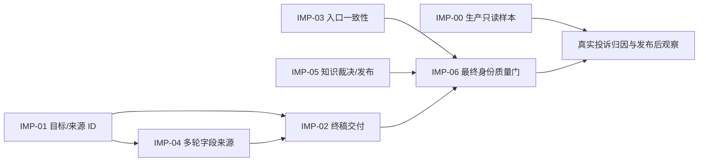

# DAQ FAE 回答质量改进总任务书

**日期**：2026-10-20。**状态**：改进设计与任务拆分已形成，尚未实施、验证或发布。本文以[完整对照结论](../../reviews/2026-10-20-daq-camera-comparison/11-analysis-summary.md)、[八项发现及反证](../../reviews/2026-10-20-daq-camera-comparison/10-findings.md)和[十一层能力记录](../../reviews/2026-10-20-daq-camera-comparison/index.md)为输入。原分析中的 `CASE/EVD/CAP/FIND` ID 保持不变；后续实施才生成 `CHG/VER/REL` ID，不预填通过状态。

## 1. 目标、基线与决策

目标是让 DAQ 在**已有已审证据时完整交付已知部分**，在证据不足时准确限定未知，并使三个入口、上下文、知识发布和质量门对此给出一致且可追的结果。相机 FAE 是工作流和专业质量门的工程基线；相机产品事实不能成为 DAQ 证据。衡量改进使用“原问目标→已审来源→可见答案”的逐项目标兑现及越界情况，不以答案字数或平均分代替。

本任务书冻结的**本机分析基线**是 DAQ 代码 SHA `ba50906bd98b4c2ce8a9b81809bf34eae0e8268ae76fdcb4e66d4cdf68dc9131`、主知识 `19d1a31b7606df155fda7d1ca8e336a845e3b78d19f15818af89e7127d2f18c0`、SDK 知识 `2bfd0538e0fa1ba46e607d8a55b63a06f9b397141b2c0192b9a6a84e2bd66d44`。这是本机正式发布快照及 10-20 发布记录中的身份，**不是本次独立读到的当前生产身份**。相机仓 `HEAD:src` 与 DAQ `HEAD:src` tree 相同；DAQ 的领域装配、知识和评测仍有独立差异。

本任务承接[10-12 工作流修复任务书](2026-10-12-daq-workflow-remediation-task-brief.md)的已完成能力和[10-19 场景架构升级计划](2026-10-19-daq-scenario-architecture-upgrade.md)的既有题集；旧版通过记录保留原身份，不重新记为未实施，也不充作本次最终身份验证。

| 路线 | 预期作用 | 本次决定 |
| --- | --- | --- |
| 只调整提示词或要求回答更长 | 可能影响表达，但不能修复目标与来源匹配 ID 为空、`safe_abstained` 漏交付仍获 `allow` 的确定性合同 | 不作为主修复机制；若有提示改动，须固定其他身份做隔离 Dev 对照 |
| 一次性导入全部 276 件原件 | 增加库存，不能使候选自动成为有角色、条件和版本边界的可答事实 | 按实际任务缺口逐项完成来源裁决与发布 |
| 分开修复目标合同、交付合同、入口注入和知识发布，并以完整身份复审 | 每个失效层都有正反例、版本和回滚边界 | **采用**；先修已有证据的兑现，再按受审证据补可答范围 |

**不可变约束**：真实模型回放只在隔离 Dev；生产只做只读身份、健康与真实反馈观察。用户附件、`tmp/` 候选和 SDK 包内用法不自动成为官方产品或组合支持事实。权限在工具检索前过滤，URL 只用本轮已核验来源。错误、fallback、outcome 和 trace 不得被静默改写。尽量只改 `daq_fae/`、DAQ 提示与题集；若修改共享 `src/`，先固定受保护上游版本并通过相机旧域回归，再更新 DAQ pin。保留 DAQ 与相机独立的代码、知识、提示、镜像和回滚目标。

## 2. 发现到工作包的完整映射

| 发现 | 已证范围与时间属性 | 首次失效层 | 改进包 | 结果不得越权声称 |
| --- | --- | --- | --- | --- |
| `FIND-001` | 旧 schema/账本失配；泛 FOV 目标在最终本机合同仍失配 | L03→L06/L07 | `IMP-01` | 不能由此称当前用户请求必经此路径 |
| `FIND-002` | 本机正式主知识 12 项需求中 5 项缺足够发布证据；27 记录引用 9 件原件 | L05 | `IMP-05` | 9/276 不是答案覆盖率；缺发布不等于无原件 |
| `FIND-003` | 最终代码+正式知识未完整跑 55 单轮/13 多轮发布题集 | L11 | `IMP-06` | 旧身份和聚焦通过不能充作最终身份整套通过 |
| `FIND-004` | 旧追问工具有 SDK 2.9.0，终稿却称缺失 | L02/L07 | `IMP-04`、`IMP-02` | 不归因为整轮历史完全丢失 |
| `FIND-005` | 旧 WARN 被写成请求失败；最终代码+旧知识聚焦 2/2 已通过 | L07 | `IMP-02`、`IMP-06` 回归哨兵 | 不称最终正式知识及生产已全域验证 |
| `FIND-006` | 当前线上原问/答案/trace、两服务生产身份缺失 | L10/观测 | `IMP-00` | 不据历史 Dev 宣布本次线上根因 |
| `FIND-007` | Dev 传 policy 问句，认证聊天/Task 省略；无模型判定不同 | L01/L08 | `IMP-03` | Task 在本发布身份关闭，不能声称实际 Task 用户受影响 |
| `FIND-008` | 最终本机代码+正式知识允许三种已知部分漏交付的假设 `safe_abstained` | L07/L08 | `IMP-02`，依赖 `IMP-01` 的目标身份 | 只证明门允许这种输出，不证明模型或生产实际发生率 |

`IMP-00` 与 `IMP-01/03/05` 可以并行准备；`IMP-01` 的目标身份合同是 `IMP-02` 的输入；`IMP-04` 的字段来源合同与 `IMP-02` 联合验收；`IMP-06` 汇合各改动的新版本结果。生产样本未取得时，已确认的本机合同和知识缺口可继续改进，但**不能关闭 `FIND-006` 或宣称当前用户投诉已解决**。

## 3. 工作包与可独立验收的交付物

### IMP-00：当前生产身份与真实用户请求闭环

**归因/责任**：`FIND-006`；运行观测与反馈负责人。**性质**：只读观测，不修改生产回答行为。可与其他包并行。

**输入与落点**：现有发布记录、`OBS-001`，认证 turn/trace/feedback；`daq_fae/authenticated_chat.py`、`daq_fae/authenticated_persistence.py`、`daq_fae/feedback_analytics.py`、`scripts/daq_feedback_analytics.py` 和部署只读健康通路。分析已证明本地 16,942 条 trace 止于发布前，公开 `/daq/api/health` 为 404；不得继续把它们当作新版本生产样本。

- [ ] 只读取得相机与 DAQ **当前**镜像/源码、runtime、模型实际回显、提示、主知识/SDK 指针、角色和入口身份；记录核查时间、响应哈希和读取权限。无权限时保留精确阻断，不猜配置。
- [ ] 从实际差评或用户给出的 2–3 条短答/弃答取脱敏原问、前文、完整可见答案、时间、角色、`trace_id/client_request_id`、后端 `done`、工具来源、需求账本、SSE/历史/UI；原件进入受限且 Git 忽略的路径。
- [ ] 对每条新案例复用原分析的十一层顺序定位**第一次**目标或证据丢失；新建稳定 `CASE`，关联 `FIND` 或登记新发现。若 UI 与后端不同，交给展示合同；若来源/账本/终稿不同，按对应包处理。

**完成门**：每条真实样本有同请求、同身份的字段链与脱敏证据哈希；无法获取时 `FIND-006=evidence_blocked`，不把“本次没有复现”记为通过。**回滚边界**：本包没有生产变更；若以后为观测改代码，应独立评估隐私、日志量和错误时的降级。

### IMP-01：用户子目标与受审来源的身份守恒

**归因/责任**：`FIND-001`、`FIND-008` 的上游；DAQ 请求 schema、工具/账本负责人。**依赖**：本机身份及 `CASE` 冻结；不等待 `IMP-00` 的生产样本。

**修改边界候选**：`daq_fae/request_schema.py`、`daq_fae/task_context.py`、`daq_fae/domain_tools.py`、`daq_fae/workflow.py`；测试 `tests/test_request_schema.py`、`tests/test_variant_family_lookup.py`、`tests/test_domain_evidence.py`、`tests/test_dev_candidate_knowledge.py`。提示只在接口合同确定后同步，不先用词面补丁。

- [ ] 把原问的实体、版本、条件、单机/组合范围和未知用户选择形成稳定 goal ID；保存原问→goal→requirement→工具参数→`matched_requirement_ids` 映射。候选 schema 不能自行授予新的产品身份或已审条件。
- [ ] 用 `CASE-004` 建精确合同：在当前角色可见且已审的有限变体集合内，分别保留 1600×1200 与 1920×1200 的水平/垂直 FOV 证据义务；用户尚未确认自有变体作为单独未知条件。四条来源可分别绑定，不能合成一组无条件数值。
- [ ] 用 `CASE-001/002/003` 证明三个既有修复不回退：HUB 口数/单口输出/整机总量分离，单机流程与三路同步分离，泛称 `led` 在用户确实询问灯态时映射到已审检查点。
- [ ] 反例涵盖错实体、错变体、错测量条件、未审红灯、只问组合时借单机流程、无用户依据的同时占口数、无权限角色；无来源目标保持 `missing/unknown`，不得为提高覆盖而删除硬条件。

**完成门**：上述各题目标数和来源 ID 与原问一致；`CASE-004` 四条带变体来源均能与相应子目标关联，变体未选仍不可提交错误的统一规格。旧版 RED、改后 GREEN、相邻负例及发布知识 ID 全部留证。**回滚边界**：只回退 DAQ 领域 schema/工具装配及其提示；知识指针不随代码回退而指向不兼容 runtime。

### IMP-02：已知部分的终稿交付合同

**归因/责任**：`FIND-008`，兼顾 `FIND-004/005`；DAQ 证据策略与合成负责人。**依赖**：`IMP-01` 稳定 goal/requirement/source 身份；需与 `IMP-06` 的独立语义门联动。

**修改边界候选**：`daq_fae/domain_evidence.py`、DAQ 终稿协议/渲染装配、`prompts/reviewed_knowledge_system.md`、`tests/test_domain_evidence.py`、`tests/test_request_schema.py`。优先设计 DAQ 自己的“已满足目标→可交付事实/适用条件→终稿单元”合同；若必须触及共享 `AnswerSubmission`/`LoopRuntime`，先给出相机默认行为不变的接口证明和双服务回归计划。

- [ ] 冻结 `EVD-007` 的六种候选终稿：`CASE-002/003/004` 各一份完整交付、一份漏交付。当前两者均 `allow` 是 RED；改后漏交付须要求修正或明确合同失败，完整交付通过。
- [ ] 对每个 `satisfied` 且用户确实请求的子目标记录可交付来源与范围；即使总体仍为 `safe_abstained`，也不能把这些已知目标写成“没有资料”。其余未满足目标、未选定变体或组合条件仍可保持未知；流程、数值、SDK 包内用法与用户现场字段各守其证据级别。
- [ ] `resolved` 继续要求全部关键目标得到相应证据；`missing/conflict/unknown` 不得被终稿单元、附件文字或相邻变体来源洗白。`CASE-006` 的 WARN/请求终态及 `CASE-005` 的 SDK 版本作为范围与字段来源哨兵。
- [ ] 不以最低字数、固定措辞或答案词面扫描充当目标兑现门。在线结构门可验证目标 ID、来源与字段完整性；**完整自然语言是否真的交付且专业可用**由 `IMP-06` 的非回答模型复审判定，不宣称结构门能独立判断全部语义。

**完成门**：`EVD-007` 的三份漏答负例从 `allow` 变为明确补答/失败，三份对应完整答案仍通过；错实体/错变体/错条件与无据正向断言仍被拦。隔离 Dev 的原案、同义改写和复合目标经独立四轴复审确认。**回滚边界**：只回退 DAQ policy/协议/提示的匹配发布组合；保留旧结果与新结果，不覆盖原始失败。

### IMP-03：Dev、认证聊天与 Task 的 policy 入参一致性

**归因/责任**：`FIND-007`；DAQ 入口装配负责人。**依赖**：可信有效问句与权限合同已明确；可独立于 `IMP-01/02` 开始。Task 仅在其功能启用时进入真实入口验收。

**修改边界候选**：`daq_fae/app.py`、`daq_fae/authenticated_chat.py`、`daq_fae/platform_tasks.py`、`daq_fae/workflow.py`；测试 `tests/test_authenticated_chat.py`、`tests/test_domain_evidence.py`、`tests/test_platform_task_adapter.py`、`tests/test_task_knowledge_binding.py`。

- [ ] 把同一可信原问/有效问以明确字段传给三个入口的 `DaqEvidencePolicy`，明确上下文改写、Task 摘录与用户原话的权威级别；不能把 Task hint 当成用户声明。
- [ ] 固定相同的需求、工具结果和假设终稿，对比 Dev 与认证路径：未明示且无已审来源的 USB 连接方式被拒，用户原话已明示或来源已核实的连接方式被允许；`EVD-005` 的差异必须消失。
- [ ] 补问题字段影响的其他门：用户输入 SDK 符号豁免、HUB 数值/测量条件、日志 request ID；授权角色、附件 owner、知识角色在注入之前及提交前继续校验。Task 关闭时记录“不适用的运行入口”，但保留代码合同。

**完成门**：同一证据与答案在三个适用入口的领域判定一致，身份/权限差异仍按入口合同正确拒绝；没有新增旧 FAE 默认路径变化。**回滚边界**：DAQ 三入口装配版本及其提示/身份配置，不能仅回退一条入口造成再次分叉。

### IMP-04：多轮字段来源与终稿一致性

**归因/责任**：`FIND-004`，兼顾 `FIND-005`；会话状态与附件负责人。**依赖**：目标字段身份与 `IMP-01` 对齐；与 `IMP-02` 联合终稿验收。

**修改边界候选**：`daq_fae/task_context.py`、`daq_fae/request_schema.py`、`daq_fae/authenticated_chat.py`、`daq_fae/authenticated_persistence.py`；测试 `tests/test_task_context.py`、`tests/test_request_schema.py`、`tests/test_authenticated_chat.py`。

- [ ] 对 `CASE-005` 逐轮保存 `SDK 2.9.0` 的原话/来源轮次、checkpoint、effective question、schema 条件、工具参数与终稿；区别“字段进入工具”与“终稿交付”。已知的用户线索不能被误列为缺失，官方兼容结论仍未知。
- [ ] 用一条追问、一条用户纠正和一条切题链验证旧字段继承与清除；历史比较固件版本不得升为当前设备版本；新变体显式覆盖旧变体；附件过期或跨 owner 不再成为本轮证据。
- [ ] 若字段因角色或知识 release 变化而失效，trace 写明失效原因；不能从旧 turn 直接复述已撤权产品事实。失败 turn 的 checkpoint、SSE 和持久历史仍保持原子一致。

**完成门**：字段来源、进入工具及进入终稿三段可对账；相邻切题/纠正负例通过；真实模型 Dev 复审不再误报已知条件缺失。**回滚边界**：DAQ checkpoint 版本和认证持久化须有读取兼容/回退方案，不能留下新旧结构无法解释的会话。

### IMP-05：按任务缺口补齐受审知识，而非扩大猜测空间

**归因/责任**：`FIND-002`；知识来源、产品/研发事实 owner 与权限裁决负责人。**依赖**：本机基线可用；不必等 `IMP-00`，线上样本取得后可调整任务优先级。

**修改边界候选**：`data/knowledge/curated/` 中的新候选与审定产物、`scripts/audit_daq_material_coverage.py`、`scripts/daq_knowledge.py`、`daq_fae/knowledge/` 发布门、`tests/test_material_coverage.py`、`tests/test_knowledge_releases.py`、`tests/test_knowledge_entitlements.py`。原始资料只在受限存储处理；Git 文档只留脱敏来源哈希/定位与裁决结果。

- [ ] 对当前 12 个原子需求建立从“权威原件→候选→已审发布→角色可见→工具检出→足以回答”的逐项台账；已发布 7 项先验证兑现，缺证 5 项逐项判定“确无权威原件 / 有原件待裁决 / 已审但未发布 / 已发布未检出”，不把 276 件库存折成完成率。
- [ ] 首批来源裁决针对 HUB 整机总输出、EGO Pro+两台 WristCam+HUB 的同步保存、指定设备/固件/SDK 组合兼容、日志 E42 的官方定义、EGO Pro 可交付官方链接。每条注明 SKU/变体、版本、平台、测量或试验条件、可见角色、来源 SHA、冲突/保密和现行审核流程的裁决结果。**特定请求是否最终失败**须由该请求的终态日志证明，交给 `IMP-02/04/06` 的附件和答案合同，不将用户现场日志发布成产品通用结论。
- [ ] 来源不足时把该项结论固定为不可答，并提供需要产品/研发或现场补的**最小证据**；不得由四个单口值推整机供电，不得由 SDK 示例推出设备组合支持，不得由用户 WARN 定义官方故障或终态，不得拼装未经验证的下载 URL。
- [ ] 有权威、获准且源检通过的事实才进入新不可变主知识/SDK/链接 release；做正确实体/条件/角色正例与错变体、错版本、无权限负例工具探针，并对实际答案在隔离 Dev 独立复审。重算来源引用、候选/发布差异及更新影响，保留旧指针和回退清单。

**完成门**：每项都有“发布可答”或“明确缺资料/权限/冲突”的可复核结果；新增可答项有来源哈希、字段范围、角色和新 release ID，未发布项不会被模型当作已知。**回滚边界**：主知识、SDK 与代码/提示的绑定身份一起回退，绝不让新代码指向不匹配的旧知识指针。

### IMP-06：反馈、冻结题集与最终发布质量门

**归因/责任**：`FIND-003`，并承接所有改动的 `VER/REL`；评测、发布与独立 FAE/Codex 复审负责人。**依赖**：待发布的各 `IMP` 候选身份冻结后执行；生产真实反馈观察属于发布后阶段。

**修改边界候选**：`evals/daq_complex_core_20261019.jsonl`（55 单轮）、`evals/daq_complex_multiturn_20261019.jsonl`（13 组/38 轮）、历史失败哨兵、`scripts/run_daq_workflow_dev_replay.py`、DAQ 发布记录与反馈审核流程。题目或预期变化产生新 suite SHA，不能改写旧结果。

- [ ] 将 `CASE-001–006`、`EVD-007` 三组正反终稿、`EVD-005` 两入口对照转为稳定的结构合同与 Dev 哨兵；覆盖 7 类任务：单事实、条件规格、复合目标、选型、SDK、排障附件、多轮。每题有已审可答边界、必须交付的已知部分、禁止的越界断言和预期 outcome。
- [ ] 在**同一个最终候选代码/主知识/SDK/提示/模型/网关/角色身份**下，完整运行 55 单轮和 13 多轮；逐题记录 question、answer、goal/requirement 状态、source IDs、tool calls、fallback、outcome、trace、耗时、模型回显与 Provider 错误。未执行项单列，不能计通过。
- [ ] 非回答模型的 Codex 或人工 FAE 按语义事实、运行硬门、工具/目标协议、用户可用表达四轴复审完整答案。正确 `safe_abstained` 需要交付已知部分并限定未知；`allow`、HTTP 200、来源数、字数不能直接计质量通过。失败保留原始结果，修复后以新身份重跑相关簇及最终发布门。
- [ ] 阻断严重型号/事实混答、权限或链接越界、无据 `resolved`、运行错误伪装缺证、已审部分漏交付；相机共享 `src` 若改动，受影响旧域合同和真实 Dev 答案须单独通过且相机生产镜像不随 DAQ 发布切换。
- [ ] 发布前记录确切源码与镜像 digest、提示 SHA、模型/网关、主知识/SDK ID、题集和复审哈希、备份与回滚演练。生产只做只读健康/身份/权限/实际反馈观察；观察窗口与足够相关任务的判据在发布决策时预先冻结，流量不足保持 `released_observing`。

**完成门**：最终身份的完整题集有逐题独立结论，所有发布阻断项为零，历史失败与相邻负例均通过；发布后真实相关反馈在预定窗口内可按 trace 复核。静态测试、局部 2/2 或旧版本 47/47 不能替代。**回滚边界**：保留 DAQ 镜像、环境、主知识和 SDK 指针的成组旧身份；共享资源/相机镜像独立核查。

## 4. 执行依赖与版本门

每个工作包只在其自身的 RED→GREEN、相邻反例、版本身份与独立审查证据齐备时标为 Dev 完成。**代码提交、知识发布、生产部署、业务观察是四个不同状态**。当前改进设计不修改服务行为，不占用 `CHG/VER/REL`；后续每项变更按[记录模板](../specs/2026-10-20-daq-fae-comparison-record-template.md)追加稳定 ID、实际负责人和状态履历。若新真实案例推翻优先级或机制，保留旧 `FIND` 的证据与反例，另记决策变化，不覆盖原结论。

| 门 | 必须保存的材料 | 失败时处置 |
| --- | --- | --- |
| G0 冻结 | 代码/上游 `src`、镜像、提示、模型/网关、知识/SDK、角色、suite SHA 与原失败 | 身份不一致先停该候选评测，不借旧结果 |
| G1 合同 | 每个包的 RED/GREEN、正确来源与匹配 ID、错实体/条件/角色负例 | 返回对应包修复，保留 RED 原件 |
| G2 隔离 Dev | 完整 55/13、失败哨兵、完整 trace/答案与独立四轴复审 | 不进入发布；新身份重跑失败簇与全量门 |
| G3 发布 | 主/SDK 知识与代码身份绑定、回滚包、相机保护门、生产只读身份/健康 | 身份不符或相机受影响则停止/回退 |
| G4 观察 | 真实投诉和相关流量的同请求证据链，预先冻结观察口径 | 保持 `released_observing` 或重开 `FIND`，不把无样本算修好 |

## 5. 状态台账与关闭口径

实施索引至少保存 `IMP ID → FIND/CASE/CAP/EVD → CHG → VER → REL → 负责人 → 当前身份 → 状态 → 剩余风险`。改进状态沿用[记录模板](../specs/2026-10-20-daq-fae-comparison-record-template.md)的 `proposed / implementing / dev_verified / released_observing / closed / reopened`；取证受阻另记阻断原因及下次检查时点，每次转换附日期、原件 SHA、复审人和前一状态。`FIND-006` 的生产归因在没有实际样本时只能保持 `evidence_blocked`；其他本机确认的修复可完成 Dev 验证，但不能借此声称真实投诉已消失。

| 工作包 | 初始状态 | 优先级与启动条件 | 首个可检查产物 |
| --- | --- | --- | --- |
| `IMP-00` | `proposed`，生产取证受阻 | P0；只读权限或用户真实案例到手即做 | 生产双侧身份及 2–3 条脱敏同请求字段链；未取得则保留阻断 |
| `IMP-01` | `proposed` | P1；本机 `CASE/EVD` 已冻结 | 四 FOV 子目标及来源 ID 的 RED/GREEN 和错条件反例 |
| `IMP-02` | `proposed` | P1；依赖 `IMP-01` 目标身份 | `EVD-007` 三组完整/漏交付正反合同 |
| `IMP-03` | `proposed` | P1；可信原问/有效问合同明确 | `EVD-005` 的 Dev/认证入口同证据对照 |
| `IMP-04` | `proposed` | P2；依赖 `IMP-01` 字段身份 | SDK 2.9.0 的原话→工具→终稿逐轮链 |
| `IMP-05` | `proposed` | P1；本机知识身份已冻结 | 五项缺口逐项来源裁决与可答边界 |
| `IMP-06` | `proposed` | P1；最终候选身份冻结 | 完整 55/13 逐题结果与独立四轴复审 |

整体改进关闭需同时满足：目标与交付合同正反例通过；知识缺口逐项有发布或明确不可答裁决；三个适用入口一致；最终身份完整题集和独立专业复审通过；生产身份可读且相关真实案例未在预定观察条件下重现。若某类资料缺少授权权威来源，知识工作包保持开放或明确阻断，而不能通过放宽证据门来换取“回答得出来”。
